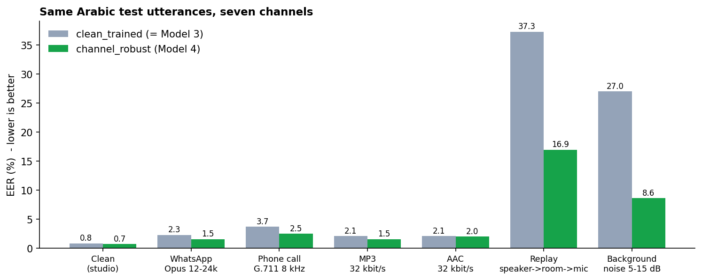
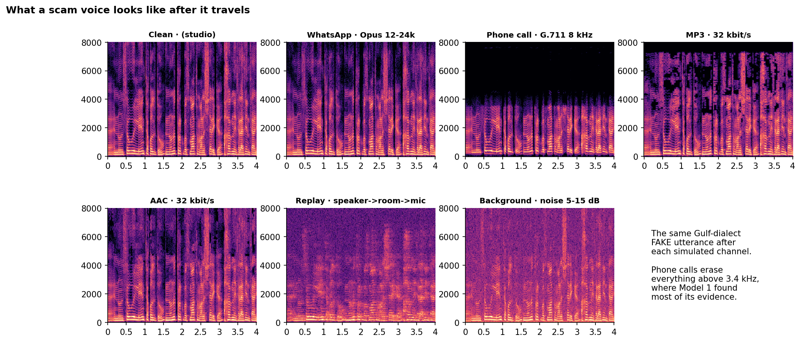
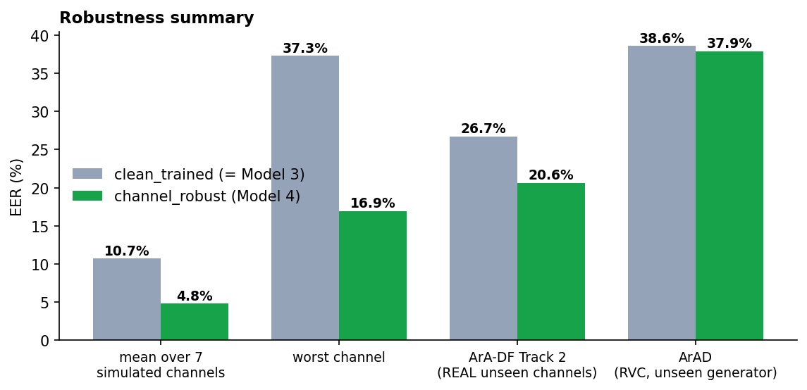

<div align="center">

# QDF-04 · Channel-Robust Arabic Deepfake Voice Detection

**A fake voice note rarely reaches the victim clean. It goes through WhatsApp, a phone line, a re-upload or a loudspeaker. Training through simulated channels cuts the mean error across seven channels from 10.7 % to 4.8 %.**


-9333ea)


Model 4 of 5 in the **QDF research series** by **Evan Deep**

[Problem](#1-problem) · [Channels](#2-seven-channels) · [Method](#3-method) · [Results](#4-results) · [Limits](#5-limits) · [Reproduce](#6-reproduce)

</div>

---

## TL;DR

Same 1 500 ArA-DF dev utterances (750 real / 750 fake, Egyptian + Gulf), pushed through every channel. EER, lower is better.

| Channel | Model 3 (clean-trained) | **Model 4 (channel-robust)** |
|---|---:|---:|
| Clean (studio) | 0.80 % | **0.67 %** |
| WhatsApp / Telegram voice note (Opus 12–24 kbit/s) | 2.27 % | **1.53 %** |
| Phone call (G.711 µ-law, 8 kHz, 300–3 400 Hz) | 3.67 % | **2.47 %** |
| MP3 32 kbit/s | 2.07 % | **1.53 %** |
| AAC 32 kbit/s | 2.07 % | **2.00 %** |
| **Replay** (loudspeaker → room → microphone) | 37.27 % | **16.93 %** |
| **Background noise** (5–15 dB SNR) | 27.00 % | **8.60 %** |
| **Mean over 7 channels** | 10.73 % | **4.82 %** |
| **Worst channel** | 37.27 % | **16.93 %** |
| *ArA-DF Track 2 dev (real unseen channels, 2 500 files)* | 26.74 % | **20.61 %** |
| *ArAD (unseen generator: RVC v2)* | 38.55 % | 37.87 % |

<p align="center"></p>

---

## 1. Problem

Model 3 reached 0.77 % EER on clean Arabic speech and found that the evidence lives in the **lower, acoustic layers** of the encoder. That is exactly the information that codecs, telephone lines and loudspeakers destroy. On ArA-DF Track 2 (recordings from channels the model never saw) its error jumped to **26.7 %**.

A voice-cloning scam in Saudi Arabia usually arrives as a **WhatsApp voice note** or a **phone call**. The investigator often has only a **re-recording** (someone played the voice note and recorded it with another phone). A detector that only works on studio-quality files is not useful in that setting.

## 2. Seven channels

<p align="center"></p>

All channels are in [`src/channel_robust/channels.py`](src/channel_robust/channels.py) and map 16 kHz → 16 kHz with the same length. Codecs are real encoders (ffmpeg round trip), not approximations.

| Condition | Implementation | Real-world case |
|---|---|---|
| `clean` | untouched | the original file |
| `whatsapp_opus` | `libopus` VoIP mode, random 12 / 16 / 24 kbit/s, Ogg container | WhatsApp / Telegram voice notes |
| `phone_g711` | 16→8 kHz, 6th-order band-pass 300–3 400 Hz, 8-bit µ-law, back to 16 kHz | GSM / landline call |
| `mp3_32k` | `libmp3lame` 32 kbit/s | re-uploads, social media |
| `aac_32k` | native ffmpeg AAC 32 kbit/s (ADTS) | iMessage, Instagram, TikTok |
| `replay` | small-speaker band-pass (120–250 Hz to 6–7.5 kHz), tanh speaker non-linearity, synthetic room impulse response (RT60 0.2–0.7 s), microphone noise 20–35 dB SNR | voice note played aloud and re-recorded |
| `noisy` | 1/f^α coloured noise, α ∈ [0.5, 1.5], 5–15 dB SNR | street, car, café |

Codec encoder delay (MP3 and AAC pad 1–2 k samples) is removed by cross-correlation, so the degraded and clean versions stay time-aligned.

## 3. Method

The encoder and head are the same as Model 3 (frozen mHuBERT-147, 13-layer mean/std pooling, standardisation, softmax layer weights, MLP). Only the **training data** changes:

| | Training set | Size |
|---|---|---:|
| Model 3 (clean-trained) | ArA-DF train (Egyptian, Gulf, MSA), clean | 7 499 |
| **Model 4 (channel-robust)** | the same 7 499 clean **+** a second copy where every file went through **one random channel** (25 % clean, 12.5 % each other channel) | 14 998 |

The test utterances (ArA-DF dev) come from different speakers and recordings than the training files, and each channel uses fresh random parameters (different seeds from training).

## 4. Results

<p align="center"></p>

**What improved**
* **Replay: 37.3 % → 16.9 %, AUC 0.67 → 0.91.** The largest gain. Replay adds room reverberation and speaker colouration that the clean model had never seen, and it mistook them for evidence of a fake.
* **Noise: 27.0 % → 8.6 %, AUC 0.81 → 0.98.**
* **Codecs** were already fairly easy (2–4 %) and improve by about a third. Even the narrow-band phone line, which removes everything above 3.4 kHz, keeps the error at 2.5 %. The lower encoder layers clearly carry evidence below 3.4 kHz.
* **Clean audio does not get worse** (0.80 → 0.67 %). Augmentation costs nothing in-domain.
* **Real unseen channels (Track 2): 26.7 % → 20.6 %.** The simulation transfers partly to real channel shift.

**What did not improve**
* **Unseen generator (ArAD, RVC v2): 38.6 % → 37.9 %.** Channel augmentation does not teach the model about new **generators**. This is a separate axis of generalisation, and only more diverse fake data will fix it.

## 5. Limits

| Limitation | Why it matters | Next step |
|---|---|---|
| Replay is **simulated** | real loudspeakers, phones and rooms are more varied than a synthetic RIR | [docs/REPLAY_PROTOCOL.md](docs/REPLAY_PROTOCOL.md): a recording protocol to collect real replay data |
| One channel per file | real paths chain channels (WhatsApp → replay → phone) | chained augmentation |
| Unseen generators stay at ~38 % | channel robustness ≠ generator robustness | more generators in training; partial-fake data (Model 5) |
| 1 500 test utterances per channel | ±~1 % confidence on EERs of a few percent | larger test subsets |

## 6. Reproduce

```bash
pip install -r requirements.txt          # plus ffmpeg with libopus and libmp3lame
# needs ../data/cache/aradf_train.npz, aradf_dev.npz (+ ssl_aradf_train.npy etc.) from Model 3
python scripts/01_extract_channel_ssl.py   # degrade + encode: ~80 min on Apple M3
python scripts/02_train.py                 # both heads + evaluation, ~2 min
python scripts/03_make_figures.py
```

```
qdf-04-channel-robust/
├── src/channel_robust/
│   ├── channels.py   # the 7 channel simulators (ffmpeg codecs, G.711, replay, noise)
│   ├── backbone.py   # frozen mHuBERT-147
│   ├── head.py       # layer-weighted head (same as Model 3)
│   ├── data.py, metrics.py
├── scripts/          # 01 degrade+encode → 02 train/eval → 03 figures
├── results/          # metrics.json, scores_*.csv, models/head_channel_robust.pt
├── docs/REPLAY_PROTOCOL.md
└── assets/figures/
```

## References

1. M. Z. Boito et al., *mHuBERT-147: A Compact Multilingual HuBERT Model*, Interspeech 2024.
2. H. Tak et al., *RawBoost: A Raw Data Boosting and Augmentation Method Applied to Automatic Speaker Verification Anti-Spoofing*, ICASSP 2022.
3. X. Liu et al., *ASVspoof 2021: Towards Spoofed and Deepfake Speech Detection in the Wild*, IEEE/ACM TASLP 2023 (LA and DF codec / channel conditions).
4. N. M. Müller et al., *Does Audio Deepfake Detection Generalize?*, Interspeech 2022, and *In-the-Wild* dataset.
5. ITU-T G.711 (µ-law PCM); RFC 6716 (Opus codec).
6. ArabicSpeech, *ArA-DF-2026*; *ArAD: Arabic Audio DeepFake Dataset*.

## Citation
```bibtex
@misc{qdf04_2026,
  title  = {QDF-04: Channel-Robust Arabic Deepfake Voice Detection},
  author = {Evan Deep},
  year   = {2026},
  note   = {Model 4 of the QDF research series}
}
```
Code: MIT. mHuBERT-147 weights and all datasets keep their own licences.
